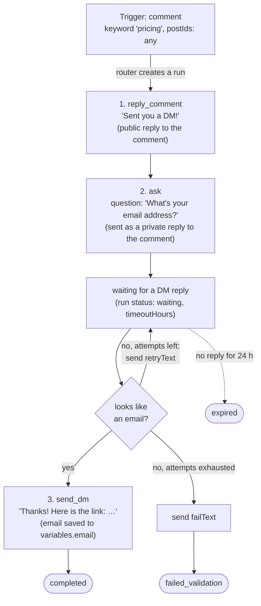
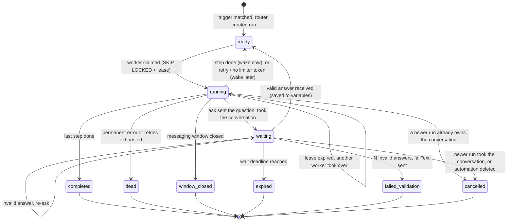

# Comment-Triggered Automations: Backend Design

Dmitrii Lytov

## Options considered

This design uses a custom engine: a state machine in Postgres plus a pool of generic workers. Below are the two options I compared, why the document describes the custom one, and when Temporal is the better choice.

Both options rely on the same invariants: durable run state, a single owner for each step at any moment, at-least-once delivery with deduplication, and waiting for a reply modelled as an event with a deadline. They differ only in who enforces those invariants. In the table, ✓ means "provided out of the box" and ✗ means "we build it ourselves".

| Aspect | Custom engine (Postgres + workers) | Temporal |
| --- | :---: | :---: |
| Persistence of run state | ✓ | ✓ |
| Replay and run history | ✗ | ✓ |
| Recovery after a worker crash | ✗ | ✓ |
| Retries with backoff | ✗ | ✓ |
| Timers and waiting with a deadline | ✗ | ✓ |
| Delivering a reply to a waiting run (signals) | ✗ | ✓ |
| Run observability | ✗ | ✓ |
| Interpreter for customer-defined steps | ✗ | ✗ |
| Idempotent sends | ✗ | ✗ |
| Rate limiting per customer account | ✗ | ✗ |

**Why this document describes a custom engine.** Temporal covers six of the rows above out of the box, and for a production system it is a serious candidate. I deliberately did not build on it here. On top of Temporal, the hardest questions of this task would each get a one-line answer, "Temporal handles it": who owns a run at any moment, what happens when a worker crashes in the middle of a send, how a reply that arrives before the run starts waiting is not lost, how a wait ends on a deadline. A custom engine forces every one of these decisions to be explicit, so the reliability and concurrency sections below show how the system actually works rather than which library it relies on. The engine is also viable on its own for this scope: scenarios are linear with a single wait, one wake-up mechanism covers starts, retries, timeouts and stuck work, and no new infrastructure is needed. The cost is that the ✗ rows are code we own and maintain.

**When Temporal is the better choice.** When the team already runs Temporal, or once we need branching, many step types and long scenarios with several waits. At that point maintaining our own timers and retries costs more than operating a new component. The model maps cleanly onto Temporal: a run becomes a workflow, a wait becomes `condition` with a timeout, an incoming DM becomes a signal, and `signalWithStart` removes the "reply arrived before we started waiting" race. Moving changes who enforces the invariants, not the invariants themselves.

## Assumptions

- The platform integration exists: we receive webhooks for comments and messages, and we can reply to comments and send DMs.
- Webhooks are delivered at-least-once: duplicates, delays and reordering are possible. For reconciliation we can periodically re-read events through the API.
- Every event has a stable platform id.
- Sending messages is not idempotent: the API has no client-side idempotency key.
- The first message to a user who has never written to us is sent as a private reply to their comment (once per comment, within a limited time after the comment). Further messages are allowed only while the 24-hour window since the user's last message is open, so the user's reply to our question is what opens the window for the rest of the scenario. Platform rate limits apply per customer account.
- The primary store is Postgres. In this document "user" means a pair (customer account, Instagram contact).

## Automation model

An automation consists of one trigger and a linear list of steps. Steps run in order; there is no branching.

**Why not a hard-coded scenario.** The task explicitly asks for extensibility, and "comment → DM → question → link" scenarios differ between customers in their texts and in the number of questions. Hard-coding would require new code for every variant.

**Why not a graph.** A graph with conditions needs an editor, validation and is hard to debug, while the only branch actually needed today ("wrong answer, ask again") lives inside the `ask` step. If real branches appear, the step list extends to a graph without changing the execution model: instead of a step index we store the id of the current node.

**Why `ask` instead of a "send DM" + "wait for reply" pair.** Validation, re-asking and the timeout all belong to one question. Inside a single step they are easy to describe and test, whereas a low-level pair of steps would force the customer to assemble this loop by hand.



Step and trigger types stored in `automation_versions`:

```ts
type TextFilter =
  | { mode: 'keyword'; value: string }
  | { mode: 'regex'; value: string };

type Trigger =
  | { type: 'comment'; filter: TextFilter; postIds: string[] | 'any' }
  | { type: 'dm'; filter: TextFilter };

type Validator = 'email' | { regex: string };

type Step =
  | { type: 'reply_comment'; text: string }
  | { type: 'send_dm'; text: string }   // template, e.g. {{email}}
  | { type: 'like_comment' }
  | {
      type: 'ask';
      question: string;
      validator: Validator;
      retryText: string;
      failText: string;
      maxAttempts: number;
      timeoutHours: number;
      saveAs: string;                   // variable name in runs.variables
    };

interface AutomationVersion {
  automationId: string;
  version: number;
  trigger: Trigger;
  steps: Step[];
}
```

This is how the scenario from the task is stored. The `ask` question goes out as a private reply to the comment; the link goes out as a regular DM after the user replies:

```json
{
  "automationId": "aut_pricing",
  "version": 3,
  "trigger": {
    "type": "comment",
    "filter": { "mode": "keyword", "value": "pricing" },
    "postIds": "any"
  },
  "steps": [
    { "type": "reply_comment", "text": "Sent you a DM!" },
    {
      "type": "ask",
      "question": "Hi! What's your email address?",
      "validator": "email",
      "retryText": "Enter a valid email address",
      "failText": "Sorry, I couldn't recognize the email. You can write to us at hello@example.com.",
      "maxAttempts": 2,
      "timeoutHours": 24,
      "saveAs": "email"
    },
    { "type": "send_dm", "text": "Thanks! Here is the link: https://example.com/pricing" }
  ]
}
```

**Trigger parameters.** A trigger defines which event and which text the automation reacts to:

- **`comment`** fires on a comment under one of the account's posts.
  - Parameters:
    - **`filter.mode`**: `keyword` (default) or `regex`. Regexes run on the RE2 engine with linear-time matching, so a customer's expression cannot stall processing (ReDoS).
    - **`filter.value`**: the keyword or expression. A keyword is matched as a whole word after text normalisation (case, whitespace, punctuation), so "pricing" does not fire on "repricing".
    - **`postIds`**: a list of posts or `any` (any post of the account).
- **`dm`** fires on an incoming message when the contact has no waiting run.
  - Parameters:
    - **`filter.mode`, `filter.value`**: same as for `comment`.

**Step parameters.** All step texts are templates over run variables (see below):

- **`reply_comment`** replies under the comment that started the run.
  - Parameters:
    - **`text`**: reply template.
- **`send_dm`** sends a message to the contact; addressing (private reply or by contact) is chosen automatically.
  - Parameters:
    - **`text`**: message template.
- **`ask`** asks a question, waits for the answer, validates it and saves it into a variable.
  - Parameters:
    - **`question`**: question template.
    - **`validator`**: `email` or a custom regex. The answer is searched for inside the reply, not matched against the whole text: "sure, it's john@x.com" yields `john@x.com`. Emails are lowercased. A reply without text (sticker, photo) counts as invalid.
    - **`retryText`**: text sent after an invalid answer.
    - **`failText`**: final message sent when no answer passed validation; goes out before `failed_validation`.
    - **`maxAttempts`**: how many invalid answers are allowed; `failText` is sent after the last one.
    - **`timeoutHours`**: how long to wait for an answer, 24 by default. It is not bound by the messaging window: the window is opened by the user's reply, and every message we send after it goes out within that window.
    - **`saveAs`**: name of the variable the answer is saved under.
- **`like_comment`** likes the comment that started the run. No parameters.

**Variables.** Every run has a set of variables in `runs.variables` (jsonb). They come from two sources. The first is the trigger context: when creating a run, the router stores `trigger.text` (the comment or message text), `trigger.post_id` and `contact.username`. The second is the answers to `ask` steps: each is saved under the name from `saveAs`; in the task's scenario that is `email`.

Step texts substitute variables with `{{name}}`, for example "Thanks! Here is the link for {{email}}". Substitution is purely textual: a template cannot evaluate expressions or code, and values are inserted as-is, without interpretation.

Templates are validated when a version is saved, not at run time. Every variable used in a step's text must be defined by the trigger or by an earlier `ask` step; otherwise the version is not saved and the customer sees an error in the editor. A `saveAs` name cannot clash with built-in variables or with another `saveAs` in the same version. As a result, a template mistake surfaces during setup, not in a user's DMs.

## Data model

Eight tables: accounts hold the plan and quotas, automation definitions are separated from their immutable versions, incoming events are stored until processed, state lives in runs and conversations, and `run_starts` keeps the "start once" business rule independent of run archiving.

```sql
-- Customer account: plan, quotas and limiter state
accounts (
  id, plan,
  quotas,           -- limits on automations and runs per day
  throttled_until   -- until when the account's runs are not picked up
)

-- Automation: mutable "header"
automations (
  id, account_id,
  status,           -- active | disabled | deleted
  current_version,
  created_at, updated_at
)

-- Immutable version: trigger + steps
automation_versions (
  automation_id, version,
  trigger_type,     -- comment | dm
  trigger_filter,   -- {mode: keyword|regex, value, post_ids | any}
  steps,            -- jsonb: [{type, params}]
  created_at,
  PRIMARY KEY (automation_id, version)
)

-- Incoming events: written before responding 200
inbox_events (
  id PRIMARY KEY,
  platform_event_id UNIQUE,
  account_id, contact_id,
  type,             -- comment | dm
  is_echo,          -- authored by the customer's own account (our replies and DMs)
  post_id, comment_id,
  text,             -- null for stickers, photos and other non-text messages
  received_at,      -- DB time at insert; all time comparisons use the DB clock
  processed_at,
  consumed_by_run   -- run that took this DM as an answer, or null
)

-- Conversation: serialization point per (account, contact)
conversations (
  account_id, contact_id,
  active_run_id,    -- run waiting for a reply, or null
  last_inbound_at,  -- for the 24-hour window
  PRIMARY KEY (account_id, contact_id)
)

-- Automation run
runs (
  id, account_id, contact_id,
  automation_id, version,          -- pinned to a specific version
  trigger_event_id, post_id, comment_id,
  status,           -- ready | running | waiting | completed
                    -- | cancelled | expired | failed_validation | window_closed | dead
  step_index,
  step_state,       -- jsonb: invalid-answer count, wait boundary, etc.
  variables,        -- jsonb: email and other answers
  attempt,          -- retry counter for the current step
  next_wakeup_at,   -- when the run should be picked up
  locked_until, lease_owner,
  last_error,
  created_at, updated_at
)

-- Business rule "start at most once": small, never archived
run_starts (
  automation_id, contact_id,
  dedup_key,        -- 'post:<post_id>' for comment triggers, 'event:<platform_event_id>' for DM triggers
  run_id,
  PRIMARY KEY (automation_id, contact_id, dedup_key)
)

-- Intent of an external call: written before the call
step_attempts (
  run_id, step_index,
  send_key,         -- logical send within the step: 'reply', 'question', 'retry:1', 'fail', ...
  attempt,
  status,           -- started | succeeded | failed | unknown
  external_id,      -- message id returned by the platform
  started_at, finished_at,
  PRIMARY KEY (run_id, step_index, send_key, attempt)
)
```

Key indexes: a partial index `runs(next_wakeup_at) WHERE status IN ('ready', 'running', 'waiting')` for worker polling, and an index on active automations `(account_id, trigger_type)` with a cache of current versions for trigger matching. For reading replies: a partial index `inbox_events(account_id, contact_id, received_at) WHERE type = 'dm' AND consumed_by_run IS NULL`. Finished runs are moved to a date-partitioned archive. Processed `inbox_events` are deleted after a retention period that is longer than the backfill polling window, so a re-polled event still hits `platform_event_id`.

**Two uniqueness keys with different meanings.** `inbox_events.platform_event_id` protects against repeated delivery of the same event. `run_starts` encodes a business rule: an automation starts for a given person at most once per post, even after the run has finished and been archived. A run under a different post is allowed. The rule lives in its own table because a unique key on a date-partitioned `runs` would have to include the partition key, and archiving would erase it. For DM triggers there is no post, so the key is the triggering event: without it, `post_id IS NULL` would make every key distinct.

## Architecture and execution model

The system consists of three stateless components around Postgres: an event receiver, a router and a pool of generic workers. Between steps a run occupies no process and no connection: it is just a row in `runs`.

Flow: Instagram → Receiver (writes to `inbox_events`) → Router (creates `runs`, updates `conversations`) → Workers (claim `runs`, write `step_attempts`) → sends to Instagram through the per-account limiter. Services communicate only through tables: a crash of any of them loses no state, and another instance continues the run.

**Receiver.** The webhook handler writes the event to `inbox_events` (duplicates are rejected by the unique key) and responds 200 immediately. Events authored by the customer's own account (our "Sent you a DM!" reply and our DMs) are stored with `is_echo = true` and never routed, otherwise an automation would trigger itself; reconciliation of unknown send outcomes reads them. Periodic polling of the platform API backfills missed events into the same table.

**Router** takes unprocessed events from `inbox_events`:

Router instances claim events with `FOR UPDATE SKIP LOCKED`; creating runs and setting `processed_at` happen in one transaction, so a router crash neither loses an event nor starts it twice.

1. An incoming DM goes to the conversation first. The router upserts the `conversations` row (recording `last_inbound_at` even for a contact's first message). If it has an `active_run_id` of a still-active run, the router wakes that run (`next_wakeup_at = now()`) and DM triggers are not evaluated for the message. The router does not validate the reply; the worker running the `ask` step does.
2. Otherwise the event is matched against the triggers of the account's active automations, using a cache of their current versions.
3. A comment starts at most one automation: if several match, the most specific wins (a list of posts over `any`, then the most recently edited). A comment allows only one private reply, so two runs on it would compete for it. For a DM, each match starts a run.
4. A run is created with `status = ready`, `next_wakeup_at = now()`, together with its `run_starts` row; a repeated start is rejected by that key.

**Workers** are generic: the step type selects a handler from a registry. Work is claimed with a single query that also takes a lease:

```sql
UPDATE runs
SET status = 'running', lease_owner = $worker,
    locked_until = now() + interval '60 seconds'
WHERE id IN (
  SELECT id FROM runs
  WHERE next_wakeup_at <= now()
    AND (status IN ('ready', 'waiting')
         OR (status = 'running' AND locked_until < now()))
  ORDER BY next_wakeup_at
  LIMIT 20
  FOR UPDATE SKIP LOCKED
)
RETURNING *;
```

A worker advances a claimed run by exactly one step: it makes the external call and then, in one transaction, advances `step_index`, resets `attempt` and releases the run (`status = ready`, `next_wakeup_at = now()`, lease cleared), or moves it to `waiting` or a terminal status. The next step goes through the shared selection again, so cross-account fairness and the limiter apply to every step, and a lease never lasts longer than one call. To avoid polling delay between steps, the worker sends a `NOTIFY` after committing and the run is picked up immediately: a few hundred milliseconds pass between "Sent you a DM!" and the question in the DM. If that latency ever matters, a worker can run several steps in a row; this is a local optimisation that does not change the data model. The condition `WHERE id = $id AND status = 'running' AND lease_owner = $worker AND step_index = $step` prevents a worker that has lost ownership, or whose run was cancelled in the meantime, from writing its result. Losing the lease is an expected outcome: the worker drops its result and moves on. A worker claims only as many runs as it processes at once, and right before every external call it renews the lease with the same fenced condition: if another worker has taken the run over, it stops before sending instead of sending a duplicate.
**A single wake-up mechanism.** `next_wakeup_at` handles everything time-related: start (`now()`), retry (`now() + backoff`), deferral due to rate limiting, and the wait deadline. A run whose lease has expired becomes eligible for selection again, so no separate job for stuck work is needed. Such a takeover counts as an attempt, so a run that keeps crashing workers ends up `dead` instead of looping forever.

Run statuses and transitions:



**The `ask` step.**

1. If a newer run already owns the conversation, finish as `cancelled` without sending anything.
2. Send the question (like any other send, see "Reliability"). Store a boundary in `step_state`: the start of the first attempt to send the question, taken from `step_attempts` (DB time). Only answers after it are accepted. Using the attempt's time rather than "now" matters after a crash: replies that arrived before another worker took over still count.
3. Move to `waiting`, set `next_wakeup_at = deadline` and register itself in `conversations.active_run_id` (see "Concurrency").
4. In the same transaction, check `inbox_events` for messages from this contact after the boundary: the answer may have arrived while the run was still sending the question.
5. On wake-up, read the oldest unconsumed reply received before the deadline, even if the deadline has passed since (the worker may wake late because of backlog or rate limiting). If it passes validation: save it to `variables`, clear `active_run_id`, move to the next step. If it fails: send the re-ask text and keep waiting; after N failures send `failText` and finish as `failed_validation`. The user always learns that the scenario has ended instead of facing a silent bot; sending `failText` follows the same rules as any DM (intent in `step_attempts`, window check).
6. If there is no reply and the deadline has passed: finish as `expired`.

Reading a reply and consuming it are separate. The step reads the reply, does its sends, and marks the reply consumed (`UPDATE inbox_events SET consumed_by_run = … WHERE consumed_by_run IS NULL`) in the same transaction as the run's commit. So each DM counts for exactly one run, and a crash, a lost lease or a transient error while sending the re-ask leaves the reply unconsumed for the next attempt; the `step_attempts` keys keep the re-sends deduplicated. Every transition into `waiting` (entering the wait, going back to sleep after a re-ask) and routing a DM lock the same `conversations` row: if the router goes first, the DM is already in `inbox_events` and the step wakes up immediately; if the step goes first, the run is already `waiting` and the router wakes it.
**Automation lifecycle.** Every edit creates a new version in `automation_versions`, and `automations.current_version` points to it. Active runs finish on their own version. Disabling stops new runs while active ones finish. Deleting cancels active runs (`cancelled`). Any terminal status, whatever caused it, clears the run's `active_run_id` in the same transaction, so a finished run never keeps a conversation.

## Reliability

The system guarantees at-least-once delivery while minimising duplicates. Losing a message is worse than sending it twice: a lost message means a lost lead, while a duplicate of most steps is harmless.

**Event intake.** An event is persisted before responding 200, so a crash after acknowledgement does not lose it. Duplicate webhooks are rejected by `platform_event_id`; missed webhooks are backfilled by periodic polling.

**Worker crash.** Run state and the step number live in the database. If a worker crashes, its lease expires and another worker picks the run up at the same step. If a worker did not crash but stalled and then woke up, its write fails: the update requires `lease_owner` and `step_index` to match.

**Recovery after a crash mid-step.** Before any external call, the worker checks `step_attempts` for the current step and send key. If there is a `succeeded` attempt, the action has already happened and is not repeated: the worker continues from where the previous one stopped. If there is a `started` attempt without a result, the outcome is unknown and the decision follows the table below. Only if there are no attempts is the action performed. For the `ask` step this means: if the question was sent and the worker crashed before moving to `waiting`, the next worker sees `succeeded` and moves the run straight to waiting without asking again. The `waiting` status is stored in the database and held by no worker, so a crash during the wait does not affect the run. A duplicate question is possible only if the connection drops at the moment of sending, and that is the deliberate price of at-least-once.

**External calls without idempotency.** Between "sent" and "recorded the result" there is always a window in which the outcome is unknown. The sequence is:

1. Before the call, record the intent in `step_attempts` (`started`).
2. Make the call with a short timeout.
3. Record the result and the message's `external_id`.

If after a restart an attempt is found in `started` status without a result, the outcome is unknown. The policy depends on the step:

| Step | Cost of a duplicate | What we do when the outcome is unknown |
| --- | --- | --- |
| `like_comment` | none, the action is idempotent | retry |
| `reply_comment` | publicly visible | look for our reply under the comment; if absent, retry |
| first message (private reply) | the platform allows one private reply per comment | look for our message by its text; if absent, retry. An "already sent" error can only come from this run, because one comment starts one run, so it counts as success |
| question in `ask` | annoying | look for our message by its text in echo events or conversation history; if absent, retry; the user's reply itself confirms delivery |
| `send_dm` with the link | almost harmless | retry |

Errors that occur before the request is sent or that the platform rejected (connection failure, 429, 4xx) create no ambiguity: the message was not sent. 429 is retried; a 4xx on validation is permanent. Only a timeout after sending and 5xx responses are ambiguous.

**Error classification.**

| Error | Reaction |
| --- | --- |
| no token in our limiter | deferred to the moment a token frees up; not counted as an attempt |
| 429, 5xx, timeout, unexpected errors (a DB hiccup, a bug) | retry with exponential backoff and jitter via `next_wakeup_at`, up to N attempts, then `dead` |
| user blocked the account, comment deleted, 4xx on validation | no retries, `dead` with `last_error` |
| messaging window closed | no retries, `window_closed` |
| customer's Instagram token expired | the run is deferred without spending an attempt and the customer is notified; reconnecting wakes the account's runs |
| worker crashed mid-step (lease expired) | another worker continues; counted as an attempt |

**Observability.** Metrics on run statuses, latency from comment to first action, and the share of `dead`, `expired` and unknown outcomes. The customer sees the history of their runs with `last_error`. The duplicate rate for unknown outcomes is tracked separately: if it becomes noticeable, reconciliation can be strengthened.

## Concurrency

All races reduce to three serialization points: uniqueness keys, the lease on a run, and the conversation row per (account, contact).

| Situation | What protects us | Result |
| --- | --- | --- |
| The same webhook arrived twice | `UNIQUE platform_event_id` | the event is processed once |
| A person commented "pricing" twice under one post | `run_starts` primary key | one run |
| Two automations match one comment | the router picks one | one private reply, one run |
| Two workers took the same run | `FOR UPDATE SKIP LOCKED` + lease | the run belongs to one worker |
| A worker stalled and another took its run | lease renewal and result write conditioned on `lease_owner` and `step_index` | the stale worker sends nothing more and overwrites nothing |
| The answer arrived before the run entered the wait | all events in `inbox_events` + a check on entering the wait; boundary from the first send attempt | the answer is not lost |
| The answer arrived while the run was busy (re-asking) | a check under the `conversations` lock before going back to sleep | the answer is not lost |
| The worker crashed after reading the answer | the answer is consumed in the commit transaction | the next worker reads it again |
| Two runs read the same answer | conditional `UPDATE` on `inbox_events.consumed_by_run` | the answer is consumed once |
| Two runs are waiting for a reply from the same person | `conversations` row with `FOR UPDATE` | only one waits |
| The automation was edited while runs were active | runs pinned to an immutable version | active runs are unaffected |

**Rule for multiple waiting runs.** At most one run per (account, contact) may be waiting. Before sending its question, a run checks whether a newer run already owns the conversation and, if so, cancels itself without sending. A new run entering the wait locks the `conversations` row, cancels the earlier active run (`cancelled`) and writes itself into `active_run_id`. The comparison uses the run's creation time, not the moment it entered the wait: if the incoming run is older than the active one, it cancels itself. Otherwise an old run delayed by retries could displace a newer one.

The cost of this rule: a person cannot go through two scenarios at once, and an answer to the old scenario's question may be taken by the new one. This is acceptable because parallel scenarios with the same person are rare, the new scenario is almost always more relevant than an abandoned old one, and ambiguous routing is worse.

**Tenant isolation.** The conversation, limits and all the rules above are scoped to the pair (customer account, contact). The same person can talk to two of the platform's customers at once, and their scenarios do not affect each other.

## Platform constraints and load

Instagram's rules and per-account limits shape the design of send steps and scheduling, so they are built into the model rather than handled as errors.

**Message addressing.** A send step has two modes. The first message to a person who has never written to us goes out as a private reply using the run's `comment_id`. Subsequent messages are addressed by `contact_id` while the window is open (`conversations.last_inbound_at` + 24 hours). The send call checks the window before going to the platform, and a "window closed" error from the platform is treated the same way: the run finishes as `window_closed` without retries.

**Per-account rate limiting.** Right before an external call (and only then: validating an answer or expiring a run takes no token), the worker takes a token from the account's limiter (a token bucket in Redis or a counter in Postgres). If no token is available, the worker does not wait while holding a slot; it defers the run: `next_wakeup_at` = the moment a token frees up. A 429 from the platform lowers that account's limiter rate.

**Fairness between customers.** A viral post produces thousands of comments within minutes on one account, and one customer can create many automations. Fairness is enforced at three levels. Workers select work per account: one batch contains at most k runs from an account (`LATERAL ... LIMIT k` with `SKIP LOCKED`; the query above is simplified and omits this). An account whose limiter is exhausted is marked with `accounts.throttled_until`, and its runs are excluded from selection instead of being claimed and deferred for nothing. The router likewise processes `inbox_events` per account in turn, so a burst of events from one customer does not delay matching for others. Plan quotas cap the number of active automations and runs per day per account. Matching considers only the automations of the account the event belongs to, so a customer with many automations slows down only themselves. In the end, comments on a viral post are processed with a delay within platform limits, and other customers do not notice.

**Scaling.** The receiver, router and workers are stateless and scale horizontally. Waiting runs consume no resources: a million waiting runs is a million rows. The bottleneck is Postgres: a partial index on `next_wakeup_at`, archiving of finished runs, and sharding by `account_id` as it grows. Polling delay can be removed with `LISTEN/NOTIFY` while the database remains the source of truth. Workers run as a pool of long-lived processes: at least two replicas for fault tolerance and autoscaling on backlog, i.e. on the number of ready runs with `next_wakeup_at <= now()` or the age of the oldest one (for example, KEDA with a Postgres scaler). Waiting runs and runs deferred by the limiter are not counted, because their `next_wakeup_at` is in the future. The upper bound on replicas is set by the Postgres connection pool (via PgBouncer). A separate worker per task (serverless) fits worse here: it needs a trigger queue, cold starts add latency, and thousands of concurrent functions cause a connection storm against the database.

## Personal data, out of scope and extensions

**Personal data.** Emails and other answers are stored in `runs.variables`, are accessible only to the account owner, and are deleted or masked after the retention period.

**Deliberately out of scope:**

- Branching and conditions between steps: the model extends to a graph by replacing `step_index` with a node id.
- Intent classification with an LLM instead of keywords: it catches "how much does it cost?", but adds latency, cost and non-determinism.
- Other platforms: send steps are abstracted behind a channel interface, but each platform has its own window and addressing rules.
- Passing the email to external systems (CRM, mailing tools) as a separate step.
- Funnel analytics for the customer (how many runs reached the answer and the link): the data for it is already in `runs`.

**When to revisit these decisions:**

- Branching and scenarios with several waits appear: move to Temporal.
- The duplicate rate for unknown outcomes becomes noticeable: strengthen reconciliation before retrying.
- Postgres can no longer keep up with polling: shard by account or use a queue as the transport.

## Use of AI

I chose the approach and designed the core of the system myself: the linear step model, storing run state in Postgres, workers claiming work with a conditional `UPDATE`, modelling the wait for a reply as a step woken up by an incoming event, automation versioning, and deduplicating runs with a unique key.

I used AI (Claude) as a reviewer: it asked questions and looked for gaps and edge cases. AI also helped turn the solution into this document.
